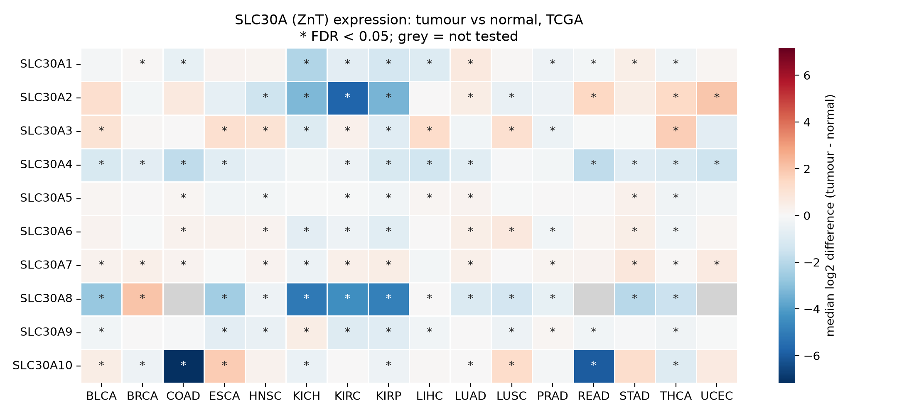
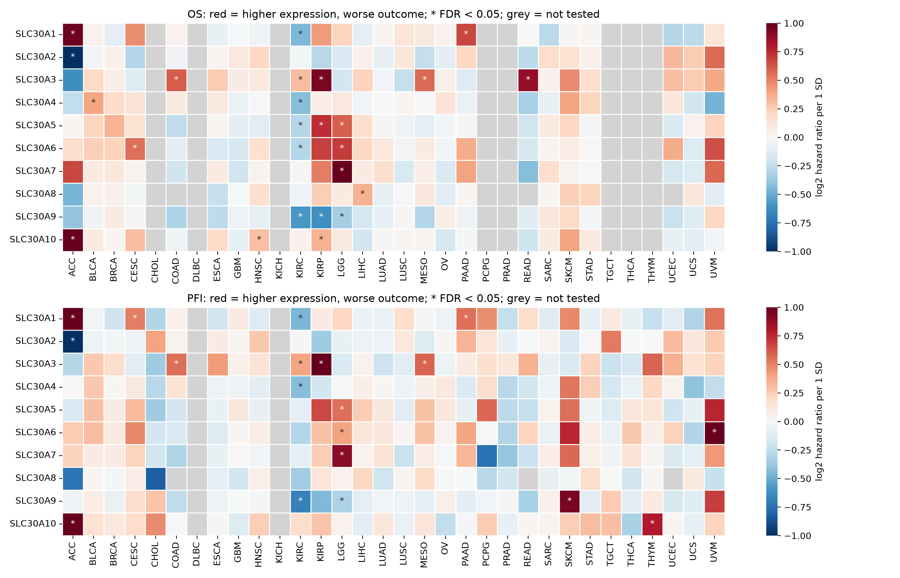
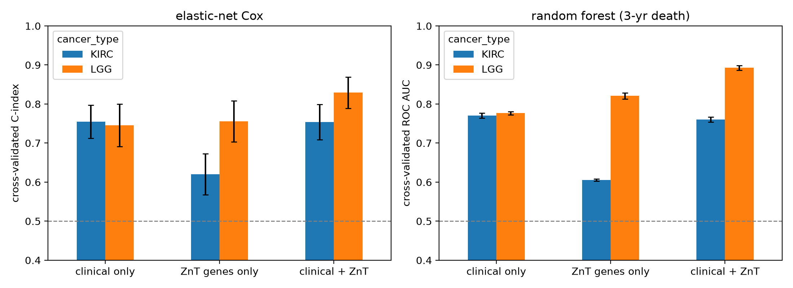
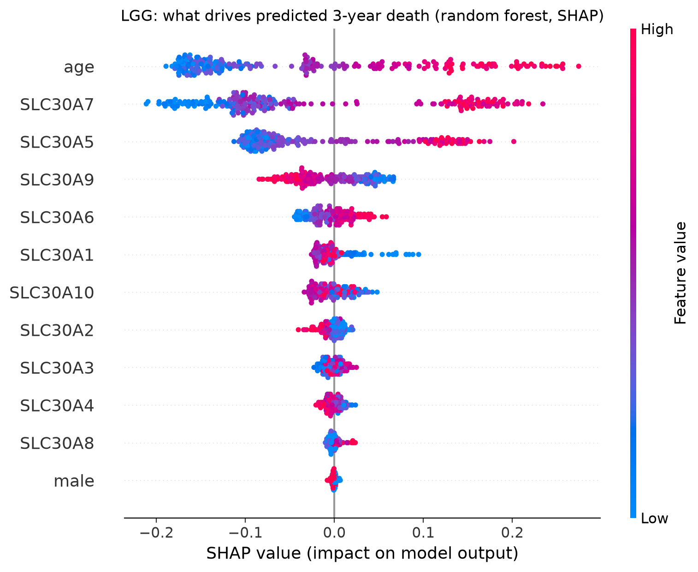

# Zinc transporters (ZnT/SLC30A) across cancers: expression and survival in TCGA

**Question:** How are the ten ZnT zinc transporter genes (*SLC30A1–10*) expressed across cancer types, and do they carry prognostic information for patient survival?

This project follows on from my MSc dissertation, a rapid review of functional studies on ZnT transporters and tumour aggressiveness (13 studies, 8 ZnT members, 8 tumour types). That review classed ZnT1, ZnT4, ZnT6 and ZnT9 as tumour-promoting, ZnT3 and ZnT7 as tumour-suppressive, and ZnT2 and ZnT5 as context-dependent. Here I ask whether large-scale patient data from The Cancer Genome Atlas (TCGA) lines up with that functional evidence.

## Key findings

1. **Large, consistent tumour–normal differences are mostly in tissue-specific ZnT genes.** *SLC30A10* is about 140-fold lower in colon tumours than in normal colon, and it is lower in all 40 patients with a matched normal sample. *SLC30A2* and *SLC30A8* are strongly reduced in all three kidney cancers. These changes most likely reflect tumours losing the identity of their tissue of origin, rather than zinc-specific biology.
2. **Most hits survive a within-patient check.** 74 of 106 significant tumour–normal differences, and 30 of the 37 large-effect differences (≥2-fold), are confirmed when each patient's tumour is compared with their own normal tissue.
3. **Expression changes do not line up neatly with the functional literature.** ZnT4 is *lower* in 12 of 16 cancers despite being classed as tumour-promoting. ZnT3, classed as suppressive, is *higher* in several cancers, and higher ZnT3 goes with worse survival in kidney, colon and mesothelioma.
4. **Survival associations are cancer-specific.** After age adjustment and FDR correction, there are 25 significant gene–cancer associations with overall survival and 19 with progression-free interval. High ZnT1 goes with worse outcomes in adrenal, pancreatic and cervical cancer, consistent with the review. High ZnT9 goes with *better* outcomes in kidney cancer and glioma.
5. **ZnT genes add prognostic value in glioma but not in kidney cancer.** In clear-cell kidney cancer (KIRC), adding ZnT genes to age, sex and stage does not improve prediction (cross-validated C-index 0.755 vs 0.754). In lower-grade glioma (LGG), it does (C-index 0.75 → 0.83; 3-year mortality AUC 0.78 → 0.89). SHAP shows this is driven mainly by ZnT7 and ZnT5. ZnT7 splits patients into two distinct groups, which suggests it may be tracking known glioma molecular subtypes (see Limitations).

## Figures

**Tumour vs normal expression** (colour = median log2 difference; * = FDR < 0.05; grey = excluded for missing data)



**Survival associations** (log2 hazard ratio per 1 SD higher expression, adjusted for age; red = worse outcome)



**Do ZnT genes add predictive value beyond clinical factors?** (cross-validated; dashed line = chance)



**What drives predicted 3-year mortality in glioma** (random forest, SHAP)



The equivalent KIRC plot is in [`results/figures/shap_KIRC.png`](results/figures/shap_KIRC.png).

## Data

All data are public, from the UCSC Xena TCGA Pan-Cancer Atlas hub:

- **Expression:** batch-corrected PanCan RNA-seq (EB++AdjustPANCAN), log2(normalised count + 1)
- **Clinical/survival:** TCGA Clinical Data Resource (Liu et al., 2018), with OS, PFI, age, sex and AJCC stage

After extraction there are 11,014 samples across 33 cancer types: 9,706 tumours, 737 normals and 626 other sample types. 16 cancer types have at least 10 normal samples and are used for the tumour–normal comparison. Raw data are not stored in this repo. `src/00_download_data.sh` downloads them.

## Methods

| Step | Script | What it does |
|---|---|---|
| 0 | `00_download_data.sh` | Downloads expression and survival tables |
| 1 | `01_extract_znt.py` | Extracts *SLC30A1–10*, labels tumour (barcode 01) and normal (11) samples, and merges with clinical data |
| 2 | `02_tumour_vs_normal.py` | Runs a Mann–Whitney U test per gene per cancer type (≥10 per group), with BH-FDR correction. Effect size is the median log2 difference |
| 3 | `03_paired_check.py` | Robustness check: Wilcoxon signed-rank test on patients with both a tumour and a matched normal sample (≥10 pairs), with BH-FDR. A hit is "confirmed" if it is significant and points in the same direction |
| 4 | `04_survival_cox.py` | Cox proportional hazards model per gene per cancer type, for overall survival (OS) and progression-free interval (PFI). Expression is z-scored within each cancer type and the model is adjusted for age. Requires ≥20 events. BH-FDR per endpoint |
| 5 | `05_ml_survival_shap.py` | For KIRC and LGG: an elastic-net Cox model compared across clinical-only, ZnT-only and combined feature sets (5 × repeated 5-fold CV, C-index), plus a random forest for 3-year mortality (CV ROC AUC) explained with SHAP |

**Missing-data rule (decided before testing):** any gene–cancer pair with more than 20% missing expression is excluded and listed. Values are never imputed. This excluded *SLC30A8* in COAD (34% missing), READ (39%) and UCEC (66%). LAML lacks *SLC30A2* and *SLC30A8* entirely, and it has no normal samples. In Step 5, the remaining rows with any missing value are dropped (complete-case analysis).

**Why effect size and not just p-values:** with hundreds of tumours per cancer type, very small differences become "significant". Results are therefore ranked and discussed by fold change, with a ≥2-fold (1 log2 unit) threshold used to flag large effects.

## Limitations

- **Normal samples are tumour-adjacent tissue**, not healthy donors, and several cancer types have few of them (READ has only 9 matched pairs, so its hits could not be confirmed by the paired test).
- **mRNA is not function.** Expression levels don't capture protein abundance, localisation or transport activity, which is what the functional studies in my review measured.
- **Bulk RNA-seq mixes cell types.** A change may come from immune or stromal cells rather than the tumour cells themselves.
- **Survival models are associations.** Step 4 adjusts for age only, not stage or treatment. They show which genes are linked to outcome, not which genes cause it.
- **The glioma result needs a stronger clinical baseline.** The clinical model for LGG includes only age and sex, because AJCC stage does not apply to gliomas. The strongest known glioma prognostic factors (IDH mutation, 1p/19q codeletion and WHO grade) are not included, and the two-group pattern in ZnT7 may partly reflect these subtypes.
- Proportional-hazards assumptions were not formally tested for every model.

## Next steps

- Add IDH status, 1p/19q codeletion and grade to the glioma model, to test whether ZnT7 and ZnT5 carry information *beyond* molecular subtype
- Check the ZnT7 finding in an independent glioma cohort (e.g. CGGA)
- Repeat the tumour–normal comparison against healthy tissue from GTEx
- Look at protein-level data (CPTAC) for the ZnTs with the clearest RNA-level signal

## Reproduce

```bash
git clone https://github.com/prithviraj-dasgupta/znt-slc30a-tcga.git
cd znt-slc30a-tcga
conda env create -f environment.yml
conda activate znt
bash src/00_download_data.sh
python src/01_extract_znt.py
python src/02_tumour_vs_normal.py
python src/03_paired_check.py
python src/04_survival_cox.py
python src/05_ml_survival_shap.py   # about 3 minutes
```

## Outputs

- `results/tumour_vs_normal.csv` and `results/tumour_vs_normal_paired.csv`
- `results/survival_cox.csv`
- `results/ml_model_comparison.csv` and `results/elastic_net_cox_coefficients.csv`
- `results/figures/` contains all figures shown above

## References

- Liu J, et al. (2018). An integrated TCGA pan-cancer clinical data resource to drive high-quality survival outcome analytics. *Cell* 173(2):400–416.
- Goldman MJ, et al. (2020). Visualizing and interpreting cancer genomics data via the Xena platform. *Nature Biotechnology* 38:675–678.
- Hoadley KA, et al. (2018). Cell-of-origin patterns dominate the molecular classification of 10,000 tumors from 33 types of cancer. *Cell* 173(2):291–304.
- Lundberg SM, Lee S-I (2017). A unified approach to interpreting model predictions. *NeurIPS* 30.
